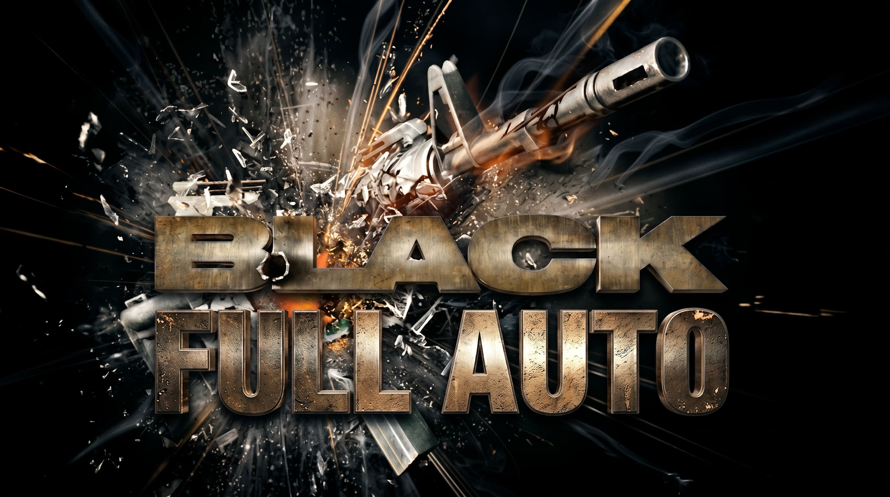
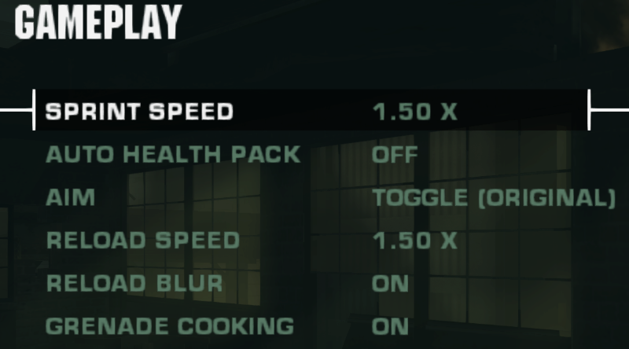
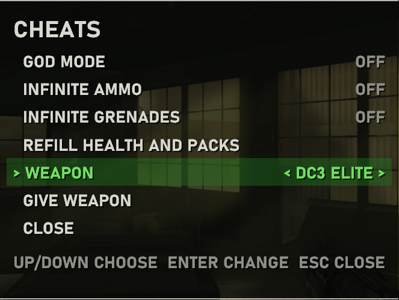
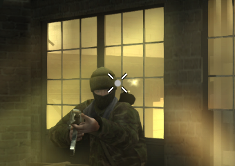
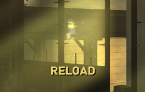
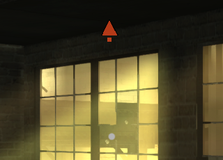
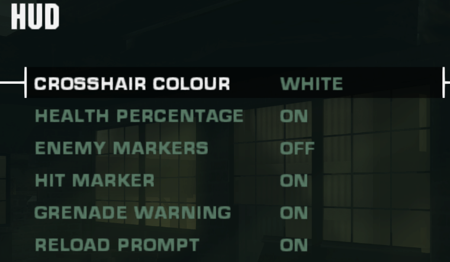
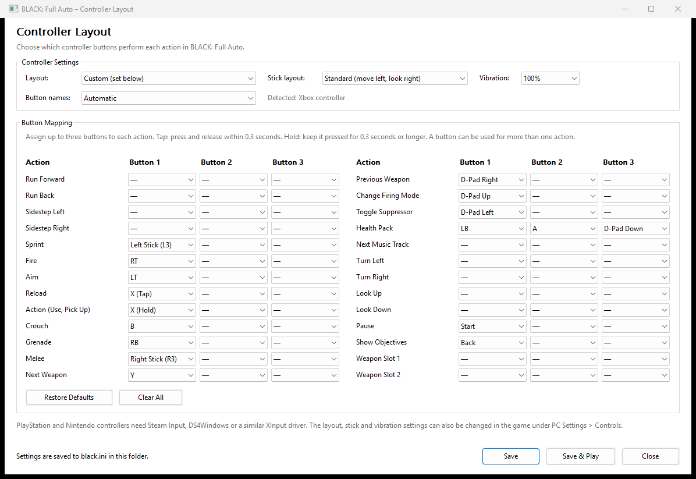
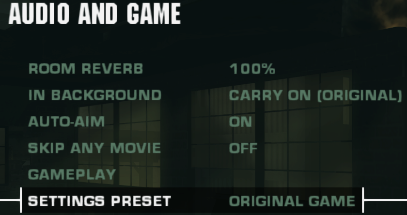

<p align="center">
  
</p>

# BLACK: Full Auto

**A fan fork of [black-pc](https://github.com/Spark198rus/black-pc) by [Spark198rus](https://github.com/Spark198rus).**

All the hard work in this port is [Spark198rus's](https://github.com/Spark198rus) : loading and running the original Xbox code natively, replacing the
Xbox kernel, Direct3D, DirectSound and the controller library with PC code, the in-game PC SETTINGS menus, mouse look,
60 fps, widescreen and everything else that makes BLACK playable on a PC. This fork adds a set of quality-of-life
extras on top, made for fun. Huge respect and thanks to Spark198rus for the original port; please star and support
[the original project](https://github.com/Spark198rus/black-pc) first. Thanks also to the projects the original port
credits below (Cxbx-Reloaded, xemu, XbSymbolDatabase, Ghidra and ghidra-xbe, nxdk), and to Criterion Games for BLACK.

**You need your own copy of the game.** Like the original, this repository and its release zips contain no game code,
data, disc images or Microsoft code. You dump your own NTSC-U Xbox disc and point the port at it (see Setting up).

## What's new in Full Auto

Everything below is added on top of the original port, and every bit of it can be turned off:
PC SETTINGS > AUDIO AND GAME > SETTINGS PRESET > **ORIGINAL GAME** switches all of it off at once and gives you BLACK
as it was.

### Gameplay

- **Sprint**: hold Left Shift (L3 on a controller) while moving forward to run faster; off, or 1.25 to 3 times
  (1.5 by default). Sprinting drops your aim, and aiming again stops the sprint.
- **Hold to aim**: aim while the button is held, or keep the game's toggle. Toggle presses made while the weapon is
  busy are no longer lost.
- **Faster reloads**: 1.25 to 2 times (1.5 by default); the hands, sounds and the moment the magazine refills stay in
  step.
- **Grenade cooking**: hold the grenade key to throw further (up to 1.5 s); the fuse burns while you hold, and after
  4 s it goes off in your hand.
- **Automatic health pack**: uses a pack for you when health drops below 20-50% (off by default).
- **Reload blur switch**: turn off the screen blur while reloading.
- **Weapon slot keys**: 1 and 2 switch straight to that weapon.
- **Cheat menu** (F1 while playing): god mode, infinite ammo, infinite grenades, refill health and health packs, and a
  weapon picker that hands you any gun the current level has, swapped in like a pickup.

<p align="center">
   GAMEPLAY" width="48%">
  
</p>

### HUD

- **Crosshair**: dot, three cross sizes, cross and dot, or circle, in white, green, red, yellow or cyan, instead of the
  game's tiny centre dot.
- **Health percentage** in the health panel, red when low.
- **Hit marker** on the crosshair when your shot or grenade hurts an enemy, red for a kill.
- **Grenade warning**: an arrow around the centre pointing at any live grenade within 10 m.
- **Reload prompt**: RELOAD / LOW AMMO / NO AMMO under the crosshair when the magazine runs low.
- **Enemy markers**: a red marker above each enemy, also through walls (off by default).

<p align="center">
  
  
  
</p>
<p align="center">
   HUD" width="60%">
</p>

### Controller

- **Modern layout** (the default): RT fire, LT aim, RB grenade (hold to cook), X tap to reload / hold to use, LB, A or
  D-pad down health pack, B crouch, Y next weapon, L3 sprint, R3 melee.
- **`black-config.exe`** to make your own: up to three buttons per action, LB / RB / L3 / R3 and the D-pad included,
  each as a press, a tap or a hold; Xbox, PlayStation or Nintendo button names for the controller it finds; southpaw
  sticks; "Save & Play" and "Restore Defaults". (PlayStation and Nintendo pads need Steam Input, DS4Windows or a similar XInput driver.)
- **Vibration strength**: off, 25, 50, 75 or 100%.

<p align="center">
  
</p>

### Settings and quality of life

- **Every setting in the game's own menus**: PC SETTINGS has new HUD and GAMEPLAY pages, in the main menu and in the
  pause menu.
- **Settings preset**: PORT DEFAULTS or ORIGINAL GAME in one step; it shows CUSTOM once you change anything.
- **In background**: carry on, mute, or mute and pause while another window is in front (the controller stops
  vibrating too).

<p align="center">
  
</p>

### Fixes

- Quick mouse clicks that went down and up between two input polls were lost (shots, aim toggles); they always count
  now.

### Developer extras

- `--press` frame-timed presses honour a hold time. The findings behind every feature above (addresses, structures,
  how each one hooks the game) are in `docs/NOTES.md`.

The rest of this README is the original port's, updated for these additions.

---

## About the port

An unofficial native Windows port of **BLACK** (Criterion Games, 2006), made from the original Xbox version (NTSC-U).

`black.exe` loads your own copy of the game's `default.xbe` and runs the original x86 game code directly on the
PC. Nothing is emulated instruction by instruction: the parts of the Xbox the game talks to (the kernel, Direct3D 8,
DirectSound, the controller library) are replaced by PC code. This is high-level emulation in the style of
Cxbx-Reloaded, built for this one game.

**You need your own copy of the game.** This repository and the release downloads contain no game code or data.

## Status

The game boots through the logos, title screen, menus and videos and is playable. The first two missions have been
played through; later missions have had less testing. Please report problems in the issue tracker and include
`port\black.log`.

- Any render resolution (720p to 4K and beyond, or a multiple of the window size), anti-aliasing
- Widescreen 16:9 (the game's own widescreen mode) or 4:3, adjustable field of view
- 60 fps (the default) or the original 30 fps
- Mouse look, with the weapon swaying as it does with the stick; keys bound to the game's actions; XInput
  controllers
- The port's settings in the game's own menus (Options > PC SETTINGS, and in the pause menu), including borderless
  fullscreen
- Room reverb, the game's own brightness and gamma ramp; auto-aim off by default; every movie can be skipped
- Fixes for things the Xbox hides by its low resolution: flickering seams between pieces of destructible objects,
  a grid pattern in the blur effects

## Requirements

- Windows 10 or 11. The program is 32-bit and runs on 64-bit Windows.
- A graphics card with Direct3D 9 (Shader Model 3). On old laptops with Intel graphics (HD 4400 class) play at 30 fps.
- The NTSC-U (North America) Xbox disc of BLACK. Other regions and builds have different code addresses and are not
  supported.

Nothing else needs installing: the C runtime is built in, and Direct3D 9, the shader compiler and XAudio2 ship with
Windows.

## Setting up

1. Dump your disc to an ISO and extract it with [extract-xiso](https://github.com/XboxDev/extract-xiso)
   (`extract-xiso -x Black.iso`). Rename the extracted folder to `game`.
2. Check that you have the supported build. In PowerShell:

   ```powershell
   Get-FileHash game\default.xbe -Algorithm SHA256
   ```

   It must print `DF2739C372D254A90AEECCF5971D12097F22D89FBB90DB021FDA96DD4DEB68F6`.
3. Download the zip from [Releases](../../releases) and extract it next to the `game` folder, so the `port` folder
   sits beside it:

   ```
   BLACK\
     game\
       default.xbe
       ...
     port\
       black.exe
       blackrt.dll
       black-config.exe
   ```

4. Start `port\black.exe`. No options are needed. (`black-config.exe` is only for changing the controller buttons.)
   Some antivirus programs (Avast, for example) flag new unsigned programs like these; if a file disappears after
   extracting, restore it from quarantine and add an exception for the `port` folder.

The port keeps everything it writes in the `port` folder: `savedata\` holds the Xbox hard disk (saved games and the
game's settings), `black.ini` the port's settings, `black.log` the log of the last run and `cache\menus` the game's menu
files with the PC SETTINGS pages added and the game's text with COMPUTER for XBOX in its messages (made again at
every start from the files in `game`). The game folder can also
be somewhere else: `black.exe D:\Games\Black\game`. Only the game window opens; `black.log` records the details of
each run.

Coming from 0.1.0 (where `black.exe` sat next to `game`): move `hdd\` into `port\` and rename it `savedata`, and move
`black.ini` into `port\`.

## Controls

Keys and mouse buttons are bound to the game's own actions, not to controller buttons, and can be changed in
PC SETTINGS > CONTROLS > KEY BINDINGS (two keys per action, saved to `black.ini`). Controllers work as well. Click
the window to capture the mouse; Esc lets go of it (in play it also pauses), and play starting or resuming takes it
again.

| Action | Default |
|---|---|
| Move | W A S D |
| Sprint (hold, moving forward) | Left Shift |
| Look | mouse |
| Fire / Aim | left / right mouse button |
| Reload | R |
| Action (use, pick up) | E |
| Crouch | C |
| Grenade (hold to cook, release to throw) | G |
| Melee | F |
| Next / previous weapon | mouse wheel down / up |
| Change firing mode | Z |
| Toggle suppressor | Q |
| Health pack | X |
| Show objectives | Space |
| Pause | Esc |
| Cheat menu | F1 |

**Controller (Call of Duty layout, the default):** left stick move, right stick look, RT fire, LT aim (while held),
RB grenade (tap to throw, hold to cook), LB / A / D-pad down health pack, B crouch, X reload (tap) or use / pick up
(hold), Y next weapon, L3 sprint, R3 melee, D-pad up firing mode, left suppressor, right previous weapon, Back
objectives, Start pause. Menus use the pad as the game always did. `pad_layout = game` in `black.ini` (or
`--pad-game-layout`) gives the game's own controller layouts back.

**black-config.exe** (next to black.exe; run it while the game is closed) sets which pad buttons do what in the port's
layout, the one thing that does not fit the in-game menus: up to three buttons per action, LB / RB / L3 / R3 and the
D-pad included, each pressed, tapped (released within 0.3 s) or held (0.3 s or longer), so one button can do two
things like X does. "Save & Play" starts the game. The lines it writes are `pad_<action> = RT` or `X.tap,LB` in
`black.ini`. The game's own hints still name its default buttons (PRESS A TO RELOAD), whatever the layout.

In menus the arrow keys move (held, they repeat), Enter selects and Backspace goes back; Enter also passes PRESS START,
skips movies and a mission's intro text, and closes the game's hints (PRESS A TO CONTINUE). QUIT at the bottom of the
main menu closes the game. On the KEY BINDINGS page left / right choose the first or second key and Enter waits for the new one
(Esc cancels, Delete clears it). Any key can be bound, F1-F12 included: the port has no keys of its own.

## Settings

The port's settings are in the game's menus: Options > PC SETTINGS on the main menu, and PC SETTINGS in the pause
menu (below OPTIONS).

| Page | Settings |
|---|---|
| VIDEO | render resolution, anti-aliasing, field of view, brightness, gamma, fullscreen |
| DISPLAY | aspect ratio, frame rate (main menu only: used from the next start), filling geometry seams, effects at Xbox size, crosshair, HUD › |
| › HUD | crosshair colour, health percentage, enemy markers, hit marker, grenade warning, reload prompt |
| AUDIO AND GAME | room reverb, in background (carry on, mute, mute and pause), auto-aim, skipping any movie, GAMEPLAY ›, settings preset |
| › GAMEPLAY | sprint speed, automatic health pack, aim (toggle or hold), reload speed, reload blur, grenade cooking |
| CONTROLS | mouse sensitivity, mouse inversion, key bindings ›, controller layout (the port's or the game's own), sticks (normal or southpaw), vibration |

Left / right change a setting; field of view, brightness, gamma and mouse sensitivity are sliders; select opens a
page marked ›, Back returns. Changes apply at once and are saved to `black.ini`. `--no-pc-menus` leaves the game's
menus as they are.

**SETTINGS PRESET** (AUDIO AND GAME) sets everything the port adds at once: PORT DEFAULTS, or ORIGINAL GAME for BLACK
as it was: every HUD extra, the crosshair, sprint, the automatic health pack, hold to aim, faster reloads, grenade
cooking, the weapon slot keys, skipping any movie, muting in the background and the port's controller layout off;
the reload blur, aim assist, the 70 degree field of view and full vibration back. Picture settings are not touched.
It shows CUSTOM once any of those is changed by hand. (Reloading by itself when you fire with an empty magazine is the
original game's own behaviour.)

`black.exe --help` lists the command-line options. They override `black.ini` for that run, for example
`--fullscreen`, `--resolution 1080`, `--fps 30`, `--fov 86`, `--normal-aspect`, `--autoaim`, `--mouse-sens 2.5`,
`--no-reload-blur`.

The game has no sprint; the port adds one. Hold Sprint (Left Shift; rebindable) while moving forward to run faster
(PC SETTINGS > AUDIO AND GAME > GAMEPLAY > SPRINT SPEED: off, 1.25 to 3 times in steps of 0.25, default 1.5). It does nothing while aiming or
crouched, and sprinting stops aiming. RELOAD BLUR off removes the screen blur while reloading. AUTO HEALTH PACK uses
a health pack for you when the health bar falls below the chosen level (20-50%) and you have one. AIM: HOLD aims while
the aim button is held; with TOGGLE (the original) a click while the weapon is busy is kept and takes as soon as it
can. CROSSHAIR replaces the game's small centre dot with a dot, three cross sizes, a cross and dot or a circle, in
white, green, red, yellow or cyan; it stays while aiming and hides outside play (`--crosshair N`,
`--crosshair-colour N`). The HUD page: HEALTH PERCENTAGE in the health panel (on by default); ENEMY MARKERS, a red
marker above each enemy's head (off by default, `--enemy-markers`; they show through walls); HIT MARKER on the
crosshair when your shot or grenade hurts an enemy (red for a kill); GRENADE WARNING, an arrow on a ring around the
centre pointing at any live grenade within 10 m; RELOAD PROMPT under the crosshair when the magazine is at a quarter
or less (LOW AMMO with no spare rounds, NO AMMO when both are empty). Keys 1 and 2 (WEAPON SLOT 1 / 2 in KEY BINDINGS)
switch to that weapon slot; the mouse wheel steps through them. IN BACKGROUND: MUTE (the default) silences the game
and stops the controller vibrating while another window is in front, MUTE AND PAUSE also pauses it. VIBRATION sets
the controller's rumble strength.

**Cheats:** F1 (CHEAT MENU in KEY BINDINGS) opens a cheat menu while playing: god mode, infinite ammo, infinite
grenades, refill health and health packs, and a weapon select that hands you any weapon the current level has (each level carries a different set of the
game's 17 guns; it swaps in like a pickup: a free slot first, otherwise your current weapon is dropped). Arrows choose, Enter / left / right
change, Esc closes; the game keeps running behind the menu but your player and view stay still. `--god`,
`--infinite-ammo` and `--infinite-grenades` start with those on.

Grenades are cooked with the keyboard: the grenade is thrown when you let go of the key, further the longer you held
it (up to 1.5 seconds), and its fuse runs while you hold. Hold it for 4 seconds and it goes off in your hand. The game's
fuse is 2 seconds from the throw. GAMEPLAY > GRENADE COOKING OFF (or `--no-grenade-cook`) gives the original throw on
the press.
RELOAD SPEED plays the reload animation faster (1.25 to 2 times; 1.5 by default, ORIGINAL for the game's speed): the
hands, sounds and the moment the magazine refills all keep in step.

Field of view (PC SETTINGS > VIDEO, `--fov`) is horizontal, in degrees; the game's is 70. The widescreen picture
keeps that width and shows less height than 4:3; 86 shows the same height as the 4:3 picture. Aiming zooms by the
same factor as before, cutscenes keep their own framing, and the gun and hands keep the game's own view (they were
made for 70 and their animations would show their ends at a wider view).

The game lets you skip a movie only once you have earned it (the intro and a mission's movies after completing that
mission, the logos never). The port lets A, START or Enter skip every movie; set PC SETTINGS > AUDIO AND GAME > SKIP ANY
MOVIE to off (or start with `--no-movie-skip`) for the original rule.

## Known issues

- The game was made for 30 fps; at 60 (the default) something may still run at the wrong speed (PC SETTINGS > DISPLAY >
  FRAME RATE).
- The game's on-screen prompts show Xbox controller buttons, also when you play with the keyboard.
- Audio: the reverb is an approximation of the Xbox's, some effect sends are not mixed, there is no subwoofer
  channel, and 3D sound uses distance and panning only.
- Only the NTSC-U build is supported (`--force` tries another build, which will most likely fail).

## Building from source

Visual Studio 2022 or 2026 (Build Tools are enough) with the C++ x86 tools, and CMake 3.24 or newer (it ships with
Visual Studio).

```
cd loader
cmake --preset win32            # Visual Studio 2026; use win32-vs2022 for Visual Studio 2022
cmake --build build/win32 --config RelWithDebInfo
```

This builds `build\win32\RelWithDebInfo\black.exe`, `blackrt.dll` and `black-config.exe`. `loader/README.md` has the
developer options and the source layout; `tools\make_release.ps1` packs the release zip.

## How it works

`black.exe` is a small stub linked at the XBE's base address, so the game's address range belongs to it before
Windows can put anything there. `blackrt.dll` maps `default.xbe` into that range, provides the 115 Xbox kernel
functions the game imports, and redirects the Xbox libraries that are linked into the game (Direct3D 8,
DirectSound, XAPI) to PC code by patching their entry points. Graphics run on Direct3D 9: the NV2A vertex programs
and register combiners are translated to HLSL. Audio is a software DirectSound mixer on XAudio2.

The game's code is never changed on disk; the few patches (60 fps timing, mouse look, auto-aim switch) are applied
in memory at start. Design notes and findings (addresses, structures, the boot sequence) are in `docs/NOTES.md`; the
original plan is `docs/ROADMAP.md`. `notes/` holds analysis results used to build the address tables: function
addresses and symbol names, the XBE header report and checksums of the disc's files. It contains no game code.

## Legal

This project is not affiliated with or endorsed by Criterion Games or Electronic Arts. BLACK is a trademark of
Electronic Arts Inc.; Xbox is a trademark of Microsoft Corporation. No code or data from the game and no code from
the Microsoft Xbox Development Kit is included. You need your own legally obtained copy of the game.

The port is free software under the GNU General Public License, version 2 or (at your option) any later version.
See `LICENSE`. BLACK: Full Auto is a modified version of [black-pc](https://github.com/Spark198rus/black-pc) by
Spark198rus, under the same licence; the changes are listed in "What's new in Full Auto" above and in `docs/NOTES.md`.

## Thanks

**Spark198rus**, for [black-pc](https://github.com/Spark198rus/black-pc): the port this fork is built on, and the
months of reverse engineering, HLE and rendering work behind it. Full Auto would not exist without it.

[Cxbx-Reloaded](https://github.com/Cxbx-Reloaded/Cxbx-Reloaded) and [xemu](https://xemu.app) served as
references for how the Xbox kernel and the NV2A behave (no code was copied).
[XbSymbolDatabase](https://github.com/Cxbx-Reloaded/XbSymbolDatabase) identified the Xbox library functions in the
game, [Ghidra](https://ghidra-sre.org) with [ghidra-xbe](https://github.com/XboxDev/ghidra-xbe) was used for the
analysis, and the [nxdk](https://github.com/XboxDev/nxdk) headers document the kernel's types.

The original port was developed by Spark198rus with Claude Code. The Full Auto additions were made for fun, also with
Claude Code.
