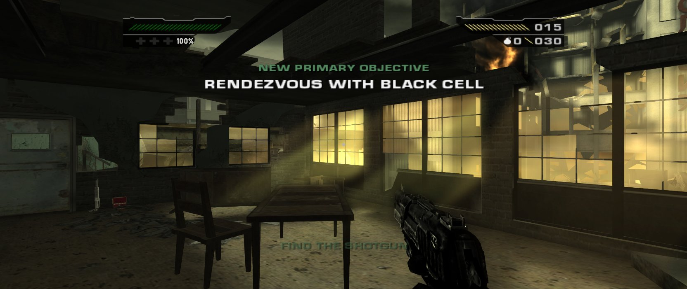

<p align="center">
  
</p>

# BLACK: Full Auto

**A fan fork of [black-pc](https://github.com/Spark198rus/black-pc) by [Spark198rus](https://github.com/Spark198rus).**

black-pc is an unofficial native Windows port of **BLACK** (Criterion Games, 2006). It runs the original Xbox game
code directly on your PC, with the Xbox kernel, Direct3D, DirectSound and controller library replaced by PC code. All of
that hard work is Spark198rus's. Full Auto adds a set of quality-of-life features on top, made for fun. Huge respect and
thanks to Spark198rus; please star and support [the original project](https://github.com/Spark198rus/black-pc).

**You need your own copy of the game.** This repository and its downloads contain no game code, game data, disc
images or Microsoft code.

> **Project status:** Full Auto is a hobby project with no regular updates or support. Bug reports may not get fixed,
> but ideas and pull requests for the Windows build are welcome and might be picked up. You are also welcome to fork
> it, change it and share your own version under the same licence (GPL-2.0).

## What's new in Full Auto

Every addition can be switched off. **PC SETTINGS > AUDIO AND GAME > SETTINGS PRESET > ORIGINAL GAME** turns them all
off at once and gives you BLACK as it was.

### Gameplay

- **Sprint**: hold Left Shift (L3 on a controller) while moving forward, at 1.25 to 3 times walking speed.
- **Hold to aim**, or keep the game's toggle, which no longer misses presses.
- **Faster reloads**: 1.25 to 2 times, with the animation and sounds kept in step.
- **Grenade cooking**: hold to throw further; hold for 4 seconds and it goes off in your hand.
- **Automatic health pack** when your health drops below a level you choose.
- **Reload blur switch** to remove the screen blur while reloading.
- **Weapon slot keys**: 1 and 2 switch straight to a weapon.
- **Tactical leaning**: lean left and right round corners and shoot from there, in small, medium or large steps.
  Assign Lean Left and Lean Right in KEY BINDINGS or `black-config.exe` (they have no default buttons).
- **Damage to enemies**: 1.5, 2 or 3 times the game's, so enemies are less bullet-spongy.
- **Blood colour**: red, dark red, green, blue or yellow instead of the game's black.
- **Cheat menu** (F1, or L3 + R3 on a controller): god mode, infinite ammo and grenades, refill health, and any weapon
  the current level has.

<p align="center">
   GAMEPLAY" width="48%">
  
</p>

### HUD

- **Crosshair**: six styles in five colours, replacing the game's tiny centre dot.
- **Health percentage** in the health panel.
- **Hit marker** when your shot or grenade hurts an enemy (red for a kill).
- **Grenade warning**: an arrow pointing at any live grenade within 10 metres.
- **Reload prompt**: RELOAD, LOW AMMO or NO AMMO under the crosshair.
- **Enemy markers** above every enemy, visible through walls (off by default).

<p align="center">
  
  
  
</p>
<p align="center">
   HUD" width="60%">
</p>

### Controller

- **A modern default layout**: RT fire, LT aim, RB grenade, X to reload (tap) or use (hold), B crouch, Y next weapon,
  L3 sprint and R3 melee.
- **`black-config.exe`** for your own layout: up to three buttons per action, including LB, RB, L3, R3 and the D-pad,
  each as a press, tap or hold, plus two-button combos such as L3 + R3. It has presets based on Call of Duty,
  Battlefield, Halo Infinite and Destiny 2, shows Xbox, PlayStation or Nintendo button names for the controller it
  detects, offers southpaw sticks, and scrolls on smaller screens.
- **Modern stick look**: the right stick turns faster when pushed part of the way, reaches full speed sooner and looks
  up and down faster. Turn and up/down speed, the stick response and the turn boost can be set in `black-config.exe`
  (Original gives the game's own feel).
- **Vibration strength** from off to 100%.

<p align="center">
  
</p>

### Display

- **Ultrawide**: 21:9 and 32:9 as well as 16:9 and 4:3 (PC SETTINGS > DISPLAY > ASPECT RATIO, from the next start).
  The view widens at the sides and the movies keep their shape with black bars. The HUD stays a 16:9 block in the
  middle, or with HUD POSITION > SCREEN EDGES the health and ammo panels sit at the screen's edges while the
  objectives and prompts stay centred.

<p align="center">
  
</p>

### Settings and other changes

- **Every setting in the game's own menus**, with new HUD, GAMEPLAY and MORE GAMEPLAY pages, from both the main menu
  and the pause menu.
- **Settings preset**: PORT DEFAULTS or ORIGINAL GAME in one step.
- **In background**: carry on, mute, or mute and pause when you switch to another window.
- **Fix**: quick mouse clicks between two input polls are no longer lost.

<p align="center">
  
</p>

### From the original port

Any render resolution up to 4K and beyond, anti-aliasing, 16:9 widescreen or 4:3, adjustable field of view, 60 fps or
the original 30 fps, mouse look, rebindable keys, XInput controllers, borderless fullscreen, room reverb, the game's
own brightness and gamma, skippable movies, and fixes for flickering seams and blur artefacts that the Xbox's low
resolution used to hide.

## Version history

- **1.1**: tactical leaning, damage to enemies, blood colour, ultrawide 21:9 and 32:9, the modern right-stick feel with
  its settings in `black-config.exe`, aspect ratio and frame rate in the pause menu, and black-config scrolling on
  smaller screens.
- **1.0**: the first release: sprint, hold to aim, faster reloads, grenade cooking, automatic health pack, weapon slot
  keys, the HUD extras, the cheat menu (also on a controller), `black-config.exe` with layout presets, and the
  ORIGINAL GAME preset.

## Requirements

- Windows 10 or 11 (64-bit; the program itself is 32-bit).
- A graphics card with Direct3D 9 (Shader Model 3). On older Intel laptop graphics, play at 30 fps.
- The **NTSC-U (North America) Xbox disc** of BLACK. Other regions and versions are not supported.

Nothing else needs installing.

## Setting up

1. Dump your disc to an ISO and extract it with [extract-xiso](https://github.com/XboxDev/extract-xiso)
   (`extract-xiso -x Black.iso`). Rename the extracted folder to `game`.
2. Check that you have the supported version. In PowerShell:

   ```powershell
   Get-FileHash game\default.xbe -Algorithm SHA256
   ```

   It must print `DF2739C372D254A90AEECCF5971D12097F22D89FBB90DB021FDA96DD4DEB68F6`.
3. Download the zip from [Releases](../../releases) and extract it next to the `game` folder:

   ```
   BLACK\
     game\
       default.xbe
       ...
     port\
       black.exe
       blackrt.dll
       black-config.exe
   ```

4. Run `port\black.exe`. Run `black-config.exe` (with the game closed) only if you want to change the controller
   buttons.

Some antivirus programs (Avast, for example) flag new unsigned programs. If a file disappears after extracting,
restore it from quarantine and add an exception for the `port` folder.

The port keeps everything it writes in the `port` folder: `savedata` (your saved games), `black.ini` (settings),
`black.log` (the log of the last run) and `cache`. To keep the game somewhere else, start it with the path:
`black.exe D:\Games\Black\game`.

## Controls

Click the window to capture the mouse; Esc releases it and pauses the game. Keys can be changed in
PC SETTINGS > CONTROLS > KEY BINDINGS.

| Action | Keyboard and mouse | Controller (default) |
|---|---|---|
| Move / look | W A S D / mouse | left stick / right stick |
| Sprint | Left Shift | L3 |
| Fire / aim | left / right mouse button | RT / LT |
| Reload | R | X (tap) |
| Use, pick up | E | X (hold) |
| Crouch | C | B |
| Grenade (hold to cook) | G | RB |
| Melee | F | R3 |
| Next / previous weapon | mouse wheel | Y / D-pad right |
| Weapon slot 1 / 2 | 1 / 2 | |
| Lean left / right | (assign in KEY BINDINGS) | (assign in black-config) |
| Firing mode / suppressor | Z / Q | D-pad up / D-pad left |
| Health pack | X | LB, A or D-pad down |
| Objectives / pause | Space / Esc | Back / Start |
| Cheat menu | F1 | L3 + R3 (both sticks pressed) |

In menus, the arrow keys move, Enter selects and Backspace goes back. Enter also skips movies and closes the game's
hints. In the cheat menu, use the arrow keys or D-pad to choose, Enter or A to change, and Esc or B to close. The
game's on-screen prompts always show Xbox buttons.

## Settings

All settings are under **Options > PC SETTINGS** in the main menu and **PC SETTINGS** in the pause menu. Use left and
right to change a setting and select to open a page marked ›. Changes apply immediately.

| Page | Settings |
|---|---|
| VIDEO | resolution, anti-aliasing, field of view, brightness, gamma, fullscreen |
| DISPLAY | aspect ratio (16:9, 4:3, 21:9, 32:9) and frame rate (both applied at the next start), seam filling, effects at Xbox size, crosshair, HUD › |
| › HUD | crosshair colour, health percentage, HUD position (ultrawide), hit marker, grenade warning, reload prompt |
| AUDIO AND GAME | room reverb, in background, auto-aim, skip any movie, GAMEPLAY ›, settings preset |
| › GAMEPLAY | sprint speed, automatic health pack, aim (toggle or hold), reload speed, grenade cooking, MORE GAMEPLAY › |
| › MORE GAMEPLAY | damage to enemies, lean, blood colour, reload blur, enemy markers |
| CONTROLS | mouse sensitivity, invert mouse, key bindings ›, controller layout, stick layout, vibration |

The field of view is horizontal, in degrees (the game's is 70; 86 shows the same height as 4:3). Aiming, cutscenes
and the gun model keep the game's own framing. The original game only lets you skip movies you have already seen;
SKIP ANY MOVIE lets you skip all of them.

`black.exe --help` lists the command-line options, which override `black.ini` for that run (for example
`--fullscreen`, `--resolution 1080`, `--fps 30`, `--fov 86`).

## Known issues

- BLACK was made for 30 fps. At 60 fps (the default), something may still run at the wrong speed; switch to 30 fps
  under DISPLAY > FRAME RATE if it does.
- The game's prompts show Xbox buttons, even with the keyboard or a custom controller layout.
- The audio is close to the Xbox's but not identical (reverb, some effects, no subwoofer channel).
- Only the NTSC-U version of the game is supported.

## Building and forking

You need Visual Studio 2022 or 2026 (the Build Tools are enough) with the C++ x86 tools, and CMake 3.24 or newer,
which comes with Visual Studio.

```
cd loader
cmake --preset win32-vs2022     # or win32 for Visual Studio 2026
cmake --build build/win32-vs2022 --config RelWithDebInfo
```

This builds `black.exe`, `blackrt.dll` and `black-config.exe`. `tools\make_release.ps1 -Build win32-vs2022` packs the
release zip. `loader/README.md` covers the developer options and the source layout, and `docs/NOTES.md` holds the
technical findings (addresses, structures, and how each feature hooks into the game).

If you publish your own fork, never include the game, its files, disc images or Microsoft XDK code. The `.gitignore`
already excludes them.

## How it works

`black.exe` is a small stub that reserves the address range the game expects. `blackrt.dll` loads `default.xbe` into
it, provides the 115 Xbox kernel functions the game uses, and redirects the game's built-in Xbox libraries
(Direct3D 8, DirectSound, XAPI) to PC code. Graphics run on Direct3D 9, with the Xbox GPU's shaders translated to
HLSL, and audio is mixed in software and played through XAudio2. The game files are never changed on disk; the patches
are applied in memory at start. `notes/` holds the analysis results used for the address tables. It contains no game
code.

## Licence and legal

Free software under the GNU General Public License, version 2 or (at your option) any later version; see `LICENSE`.
BLACK: Full Auto is a modified version of [black-pc](https://github.com/Spark198rus/black-pc) by Spark198rus.

This project is not affiliated with or endorsed by Criterion Games or Electronic Arts. BLACK is a trademark of
Electronic Arts Inc., and Xbox is a trademark of Microsoft Corporation. You need your own legally obtained copy of
the game.

## Credits

- **[Spark198rus](https://github.com/Spark198rus)** for [black-pc](https://github.com/Spark198rus/black-pc), the
  port this fork is built on, and the months of reverse engineering, emulation and rendering work behind it. Full Auto
  would not exist without it.
- **Claude** (Anthropic's AI, through Claude Code) wrote the Full Auto changes; the original port was also built with
  Claude Code.
- [Cxbx-Reloaded](https://github.com/Cxbx-Reloaded/Cxbx-Reloaded) and [xemu](https://xemu.app) served as references
  for how the Xbox behaves (no code was copied). [XbSymbolDatabase](https://github.com/Cxbx-Reloaded/XbSymbolDatabase),
  [Ghidra](https://ghidra-sre.org) with [ghidra-xbe](https://github.com/XboxDev/ghidra-xbe) and the
  [nxdk](https://github.com/XboxDev/nxdk) headers made the analysis possible.
- Criterion Games, for BLACK.
